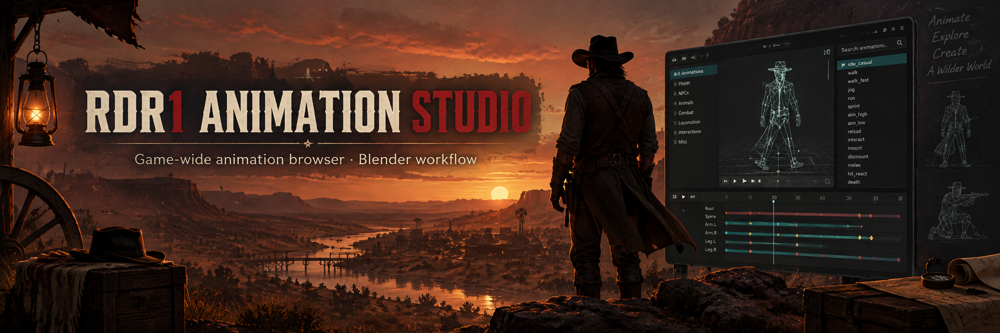
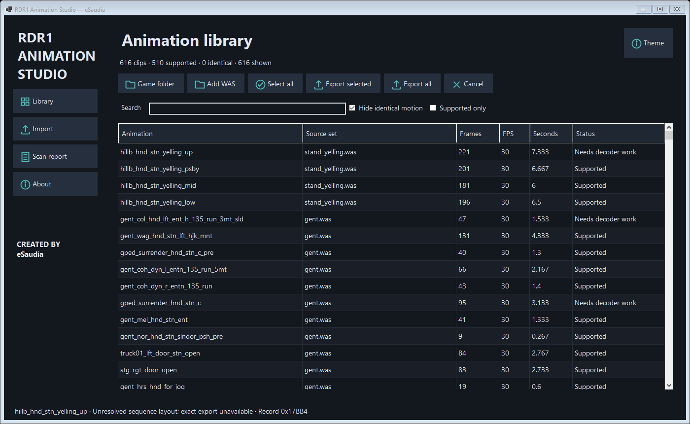
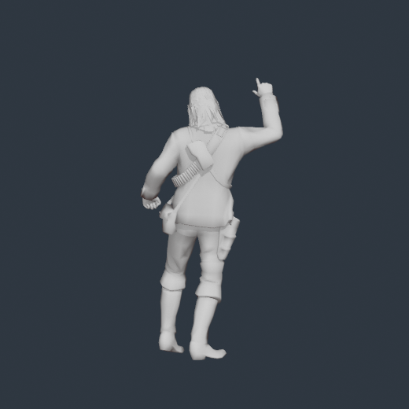

# RDR1 Animation Studio 0.13 · Mission Record Index

Created by **eSaudia — Creator & Project Owner**.

RDR1 Animation Studio is a focused Windows workbench for exploring the original
Red Dead Redemption animation archives and preparing them for Blender. It is a
research and modding tool: it does not include Rockstar game files and it never
writes to your RPF archives automatically.

## See it in action

The application indexes real WAS clip records, keeps their source identity, and
lets you export a single clip, a selection, or an entire animation set.



Exported actions can be opened in Blender on the bundled human skeleton. The
demo below shows the exported animation workflow and playback timing.




## What it can do

- Scan a selected RDR1 game directory and discover animation sets across RPF files.
- Add individual extracted `.was` files for focused inspection.
- Show internal clip names, frame counts, FPS, source archive, and support status.
- Detect identical decoded motion without hiding clips merely because their names match.
- Export selected clips or all clips from a WAS set to Blender-compatible files.
- Preview supported clips on the bundled John rig or a discovered WFT character mesh.
- Decode WFT character geometry into a cached, skinned glTF preview without writing to RPF archives.
- Preserve source IDs and validation metadata for experimental Blender round trips.
- Provide a dark/light theme and a report when a clip layout is unsupported.
- Create custom Blender authoring scenes, including a Spider leap demo preset.
- Package selected supported clips into a portable, deduplicated animation pack with a validated manifest.

## Library

Choose **Game folder** to collect animation sets from all RPF archives beneath the
selected installation. The initial scan decodes motion to check support and identify
identical content, so it can take several minutes. Progress and Cancel are available.
**Add WAS** also loads extracted animation sets.

The library shows actual internal animation names, source sets, frame counts, timing,
and support status. It does not invent friendly names for unresolved resources.
Each clip is identified by its source and record offset. Identical names are not
treated as evidence of identical motion. **Hide identical motion** uses decoded-track
fingerprints; unrecognized layouts remain visible with an explanation in Scan report.

The interface has Library, Authoring, Packs, Import, Scan report, and About sections, custom drawn icons,
and a top-right Theme switch. Dark is the default. The old renderer and filename-database
control have been removed. Filename resolution runs automatically internally.

The **Character** picker is populated after a game-folder scan. **John · bundled human rig**
works without a game model; discovered `.wft` assets are decoded on demand and cached in
`%LocalAppData%\\RDR1AnimationStudio\\Characters`. WFT meshes must use the bundled player
skeleton mapping; incompatible or malformed resources are reported in the preview panel.

## Export to Blender

Select rows using Ctrl/Shift or Select all, then **Export selected**. **Export all** uses
the entire collected library regardless of search or visibility filters. Identical
decoded motion is exported once with aliases in the report. Unsupported clips are
reported rather than replaced with another clip or stretched to fit a guessed timeline.

Exports are named Blender Actions on the bundled human skeleton, in files grouped by
source with at most 50 Actions per file. Character-aware WFT geometry is currently a
preview feature; Blender export remains deliberately skeleton-first so exported files are
stable and compatible with the existing round-trip importer. NLA playback is disabled to
prevent interference with the active Action.
The output folder includes `export-report.json`, source identities, and glTF files.
Animations incompatible with the supplied human skeleton are reported as unsupported.

## Experimental Blender import

1. Export a supported clip with version 0.8 and edit its Action in Blender.
2. Keep its Action name, skeleton, original 30 FPS timeline, and frame count.
3. Select the original clip in Library, open Import, and choose the edited `.blend`.
4. Save to a new `.was` filename. Inspect the adjacent validation report.

Source hashes and record IDs stored on the Action must match. The importer currently
updates supported tracks in their existing storage layout. It can reject changes that
need larger storage, constant-to-animated changes, shared tracks, unknown layouts,
unsupported bone transforms, scale changes, or excessive quantization error.
Root-motion channels take precedence over ordinary root channels, matching export;
ordinary root channels are preserved. This is not general retargeting or FBX import.

The result is decoded and compared with imported samples. An unchanged Blender round
trip and a small root-motion edit were verified using a real WAS sample. In-game loader
acceptance has not been tested. RPF archives are never written automatically.

## Custom authoring and packs

The **Authoring** section creates a Blender scene from the bundled 119-bone human rig.
Choose an action name, frame count, FPS, and either a blank pose or the **Spider leap**
demo preset. Edit the Action in Blender and save the `.blend` file.

The **Packs** section creates a portable folder from selected supported Library clips.
It stores each source WAS once under `sources/`, writes exact record offsets and timing
to `manifest.json`, and provides a validator. Packs are staged for a future ScriptHookRDR
runtime menu; a loose JSON/WAS folder is not loaded by the game, and no game archive is
overwritten automatically.

## Scene playback and rendering

The **Scenes** section can open any exported `.blend` in Blender's camera view and
start its timeline automatically. **Render scene to MP4…** runs Blender in headless
mode at the scene's own frame range and FPS, writing an H.264 movie without changing
the source `.blend`. The current intro scene remains a procedural sample: its actor
motion and shot markers are real Blender data, while mission cameras, props, AI
tasks, and audio are still future decoded inputs.

### Faster repeat scans

The first scan of a game folder still has to read its RPF archives and decode each WAS
set. RDR1 Animation Studio now stores an archive inventory, extracted-source manifest,
and decoded catalog under `%LOCALAPPDATA%\RDR1AnimationStudio\Cache`. Selecting the
same unchanged game folder again reuses those results; changing an RPF automatically
invalidates the affected cache.

### Resource semantics (research milestone)

The Scan report includes **Decode resource semantics…** and the command-line
equivalent below. It produces a portable `.semantics.json` evidence report:

```powershell
RDR1AnimationStudio.exe --decode-resource extracted-resource.bin report.semantics.json
```

The desktop **Decode resource semantics…** action automatically forwards a
discovered native database. For scripting/CI, invoke the bundled helper
directly when you want name resolution:

```powershell
python Tools\WasInspector\resource_semantics.py extracted-resource.bin --output report.semantics.json --native-db Assets\rdr1-natives.json
```

If a standalone Python 3.12 install is not present, the desktop app can use
Blender's bundled Python runtime (current Blender 5.2 builds ship Python 3.13)
for this decoder. Databases larger than 128 MiB are intentionally not loaded
into memory; hashes remain in the report and the selected database path is
preserved so a malformed multi-gigabyte JSON cannot freeze the studio.

The Scan report also provides **Import native database…**. Choose the downloaded
JSON once and the app stores it at `%LOCALAPPDATA%\RDR1AnimationStudio\natives.json`.
When parameter metadata is present, each decoded call additionally reports
`nativeParameterTypes` and `nativeReturnType`, so a script review can distinguish
an actor, camera, AI, or audio native from an unknown hash.
The decoder compares the encoded VM parameter/return flags with that metadata and
marks each call `signatureStatus: match|mismatch`; mismatches are counted in both
the resource report and the archive-wide index. This is a consistency check, not
a claim that the database or script is authoritative.

Validated VM reports now also include bounded `controlFlowEdges`, `callReferences`,
per-function `nativeCalls`, and a sorted `nativeUsage` summary. The archive-wide
index aggregates those usage counts across all mission resources. These are
evidence links and call-site references; they do not claim that unresolved branch
or event payload semantics have been fully decompiled.

The Scan report's **Explore native usage…** action opens an archive-wide index,
filters by hash or resolved name, and exports the visible table as CSV. This makes
large mission scans practical to review without opening the raw JSON manually.

The companion **Explore VM scripts…** action lists every indexed mission resource,
its validated header/function/call counts, archive, and internal path. It supports
the same filter-and-CSV workflow, so high-value script candidates can be triaged
before attempting deeper reverse-engineering.

For a focused experiment, **Decode one mission…** lets you choose a single
mission resource from the scanned inventory and writes one `.mission.semantics.json`
report. It extracts and decodes only that resource, optionally resolves native
hashes from the configured database, and leaves all other missions untouched.
For RSC85 v2 resources this now applies the validated AES-256-ECB (16-pass)
transform, expands the Zstandard frame, and inspects the resource-script header
before returning bounded VM evidence. This is the recommended first step when
validating a new VM hypothesis.

The focused decode also creates a sibling `<mission>.mission-package-YYYYMMDD-HHMMSS`
folder beside the report. It contains the original `.wsc` bytes, an exact
`payload.bin` slice, a bounded `payload.hex.txt` preview, `mission.semantics.json`,
and `mission.manifest.json` with archive path, RSC header flags, SHA-256 hashes,
and an explicit list of unresolved layers. For RSC85 v2 resources it also
contains `payload.decrypted.bin` and `payload.decrypted.hex.txt`, the exact
AES-transformed payload used for inspection (the original bytes are preserved).
When the Python decoder is available it also includes
`payload.expanded.bin` and `payload.expanded.hex.txt`, the 20,480-byte virtual
resource after Zstandard expansion. This makes one mission reproducible for
reverse-engineering. The same package can be generated headlessly with:

```text
RDR1AnimationStudio.exe --decode-mission <content.rpf> <mission-or-path-query> <output-folder> [ImportedFileNames.txt]
```

Each package also includes `rsc85.probe.json`. The probe records payload entropy,
standard compression signatures, aligned page windows, and shape-only LZX header
candidates. RSC85 v2 entries now record the validated AES transform and decrypted
Zstandard signature. The semantic report includes the virtual-page/object-start
layout, resource-script header, code-page table, native table, and bounded
bytecode instructions. Mission-specific event timing, camera/AI/audio payload
meanings, and physical-page relocation remain explicitly unresolved.

On the focused `dlc_find_blunderbuss.wsc` sample, this produces a reproducible
20,480-byte expanded resource with 105 embedded functions, 3,165 decoded
instructions, 361 bounded branch/call references, and 159 calls resolved to
another function marker across 120 unique internal call-graph edges. Each
function now has a generated structural label (`main`/`Function_N`), parameter
and local counts when the marker provides them, and incoming/outgoing function
indexes. This is the first concrete VM-structure milestone and provides the
stable execution map needed for typed mission-resource correlation.

Focused packages now also emit `mission.trace.json`. It is a bounded,
source-order trace of validated function entries, native calls, internal calls,
branches, and returns, plus per-function summaries. It distinguishes decoded
native-table hashes from native indexes that still lack a valid table entry.
The trace is intentionally not presented as runtime execution: branch conditions, loops, event timing,
and typed payload fields remain listed as unresolved until those records are
validated.

The correlation pass adds bounded `typedRecordCandidates` and
`missionTraceCorrelation` fields to expanded mission reports. Printable labels
are retained with their source offsets and grouped into conservative camera,
actor, AI, prop, audio, animation, and timing domains. The correlation report
only says that a trace domain and a resource-label candidate coexist; it does
not claim that a label is an object instance or that a native call carries a
decoded event payload. RBF0/XML reports use the same candidate schema, so the
cutscene/resource evidence can be compared with the VM trace without inventing
binary fields. Runtime branch decisions, record identity, transforms, AI task
arguments, and audio codec data remain explicitly unresolved.

For the focused `dlc_find_blunderbuss.wsc` sample this produces 81 bounded
record candidates across all seven domains. Because the current local native
database is over the safe read limit, the trace reports resource candidates but
does not invent native-name matches; the result is intentionally marked
`resource-candidate-without-trace-domain-evidence` until a validated native
table and typed event stream are available.

Focused mission packages also emit `mission.records.json`. This is a compact,
stable index of those candidates: each entry has a generated record id, source
offset, candidate type, domains, and up to 32 source-order trace event
references. It is designed for filtering and later schema validation, so it is
not a list of confirmed runtime objects. The same index can be requested from
the headless decoder with `--records-output <path>`.

The following correlation layer is now included in each VM report. When a
native database supplies a resolved name, calls receive conservative domain
hints (`camera`, `actor`, `ai`, `prop`, `audio`, `animation`, or `timing`) and
an archive-wide call-count summary. The containing function is recorded for
each hint, so the report can show which execution nodes touch a domain.
Printable identifiers in the expanded resource are grouped into the same review
domains, with the original names preserved. These are explicitly labelled
lexical evidence and never convert an unknown hash or payload field into a
claimed game semantic.

The release also contains a small `Tools\\XMemProbe\\Rdr1XMemProbe.exe` helper for
the next reverse-engineering step. It is a separate 32-bit process because the
game's legacy `xcompress32.dll` is 32-bit. Run it explicitly with a candidate
expanded size and the directory that contains the user's copy of
`xcompress32.dll`:

```text
RDR1AnimationStudio.exe --probe-xmem <payload.bin> <expanded-size> stream|block [--pad16] <xcompress-directory>
```

The helper emits JSON with the native return code, consumed/written sizes,
output hash and a conservative resource-header check. A failed or crashed
candidate is isolated to the child process; it is never presented as decoded
VM data. It is retained for legacy LZX candidates; RSC85 v2 missions use the
AES/Zstandard path above. The helper's source and the .NET Framework x86 build command are in
`Tools\\XMemProbe`.

RSC85/86 physical-page relocation is intentionally marked unresolved. Virtual
page sizing and the object-start offset are now decoded from the extended flags;
the older RSC05/06 bitfield formula is not applied to these resources because
doing so yields false expanded sizes for mission payloads.

The same report can be opened with **Open JSON report…**. The viewer provides a
syntax-colored raw JSON tab and a navigable structured tree tab, so reports do not
need to be inspected in an external editor.

After an export or decode completes, choose **Open it in the Raw / Structured JSON viewer now?**
to jump straight to the generated report. Reports larger than 64 MB automatically use a bounded streaming viewer. It shows
512 KB raw windows (first/last or a chosen byte offset) and a structured safety
summary instead of loading a multi-gigabyte audio report into memory.

The first mission decode may spend a short time locating the bundled Python
runtime. That result is cached for the session and subsequent decodes start
immediately; the decoder also runs off the UI thread so the window remains
responsive while a report is being written.

After a game-folder scan, **Build VM header index…** extracts the identified
mission resources to a temporary workspace, expands supported RSC/Zstandard
payloads, and writes one archive-wide `rdr1-mission-vm-index.json`. The temporary
files are removed after indexing; only the report is retained. The index now
also totals unique internal call-graph edges and any resolved-native domain
hints, while preserving each resource's local graph and identifier hints.

Validated `camera.rpf` entries that contain XML are decoded into typed elements
and attributes (booleans, integers, floats, references). Validated `RBF0`
cutscene resources are indexed by class, object type, camera/actor/prop/audio/
effect/subtitle labels, event-record count, and source byte offset. Expanded RSC
mission payloads also include candidate image-base pointers and a raw word-opcode
histogram for reverse-engineering comparison. When a payload contains the
validated RDR script header, the report adds a bounded VM disassembly: opcode byte,
instruction offset, raw bytes, validated argument width, and control-flow target
where the format is known. It also records the header signature, code length,
native/static counts, relative-pointer fields, and code-block starts. RDR's
embedded `Function` markers are discovered inside each bounded code stream, so
the report exposes every validated function boundary (not just the first
function) and records whether each body ended at a return or a safety boundary.
The complete 0–178 opcode enum is covered, including the post-155 patch,
reference, and vector instructions. Names and size rules are cross-checked
against the public RDR backend in [RASM](https://github.com/NativeFunction/RASM).
The validated static table is also hashed and exposed as bounded little-endian
initial values (with a non-zero count and truncation flag for unusually large
tables); the expanded binary remains the lossless source for every value.
`CallNative` entries now include the encoded parameter/return bits and the raw
32-bit native-table hash when the header points to a valid table. This milestone
can also resolve those hashes to names without bundling third-party data: pass
`--native-db`, set `RDR1_NATIVE_DB`, place `Assets\rdr1-natives.json` beside the
application, or put `natives.json` in `%LOCALAPPDATA%\RDR1AnimationStudio`.
The loader accepts either a hash-to-name object or records containing `hash`/
`nativeHash` and `name`/`command` fields. The archive-wide VM index accepts the
same `--native-db` option and records the database path/count. A community source
such as [rdr-nativedb-data](https://github.com/TheRouletteBoi/rdr-nativedb-data)
can be used after checking its license; the app never downloads it automatically.
Generic RSC objects are deliberately not disassembled merely because they contain
relative pointers; they remain evidence-only until a script header is found. RSC
wrappers, Zstandard frames, and unknown streams are identified without pretending
their payload has been decoded. Native hash/name resolution, event timing payloads,
camera transform records, AI task arguments, and audio-bank codecs remain explicitly
marked unresolved until their layouts are independently validated.

## Requirements / build

Windows x64, .NET 10 Desktop Runtime (or SDK), Python 3.12 x64, and Blender. A Python 3.12
zstandard dependency is included. Blender 5.2 was used for integration tests.

```powershell
dotnet build -c Release
dotnet publish -c Release -r win-x64 --self-contained false
```

52 Python tests cover codecs, duplicate identity, timing rejection, import writes,
shared-track rejection, and existing decoder behavior. See WAS-ROUNDTRIP.md for the
earlier encoder research; that document describes version 0.7, not the current UI.
