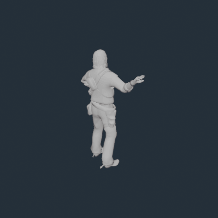

# RDR1 Animation Studio

A Windows toolkit for exploring the original **Red Dead Redemption (RDR1)** animation archives and preparing animations for Blender.

Created by **eSaudia — Creator & Project Owner**.

## Highlights

- Scan a selected RDR1 game directory and discover animation sets across RPF archives.
- Add individual extracted WAS files for focused inspection.
- View real internal clip names, frame counts, FPS, source archive, and support status.
- Select one clip, multiple clips, or every clip in a WAS file.
- Export selected or all supported clips to Blender-compatible files.
- Detect identical decoded motion without hiding clips just because names match.
- Preserve source IDs and validation metadata for experimental Blender round trips.
- Dark/light theme, custom interface, and clear scan/export reports.

## Installation

1. Download the Windows package from the [v0.9.0 release](https://github.com/eSaudia/RDR1-Animation-Studio/releases/tag/v0.9.0).
2. Extract the ZIP to any folder.
3. Run RDR1 Animation Studio.exe.
4. Choose your own Red Dead Redemption game directory, or add an extracted WAS file.

The tool does not include Rockstar game assets and does not write to your RPF archives automatically.

## Export workflow

Choose a WAS animation set, select the clips you want, then use Export selected or Export all. The output includes Blender actions, source identities, and an export-report.json. Unsupported layouts are reported instead of being replaced with guessed data.

Exported actions use the bundled human skeleton and preserve the original 30 FPS timing. A matching character mesh is not included in the export workflow; use your own RDR1 character assets in Blender.

## Experimental Blender import

Edited Blender actions can be imported back into a new WAS file for supported layouts. The importer validates the original action name, skeleton, frame count, source record, storage limits, and quantization error. Always keep the original files backed up and test imports on copies first. In-game loader acceptance is not yet guaranteed.

## Requirements

- Windows x64
- .NET 10 Desktop Runtime (or SDK)
- Python 3.12 x64 (bundled with the release)
- Blender for viewing exported actions

## Links

- [Download v0.9.0](https://github.com/eSaudia/RDR1-Animation-Studio/releases/tag/v0.9.0)
- [Windows ZIP](https://github.com/eSaudia/RDR1-Animation-Studio/releases/download/v0.9.0/RDR1-Animation-Studio-v0.9.0-win-x64.zip)
- [Research and extraction notes](RELEASE-v0.9.0.md)

## Credits

**eSaudia — Creator & Project Owner**

RDR1 Animation Studio is an independent research and modding project. Red Dead Redemption and its assets are property of Rockstar Games.
